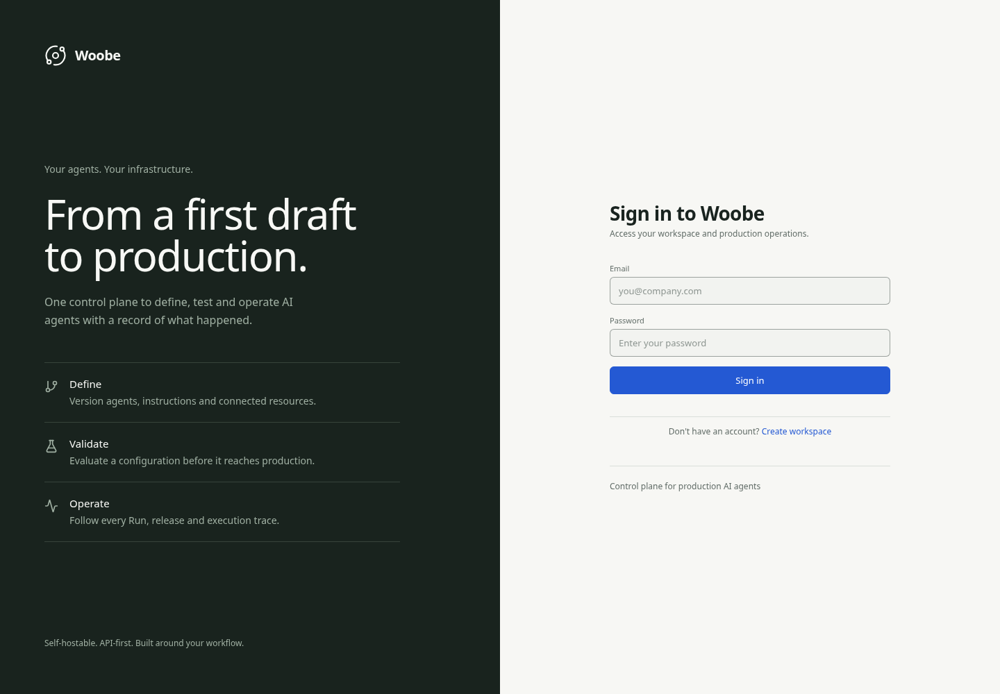
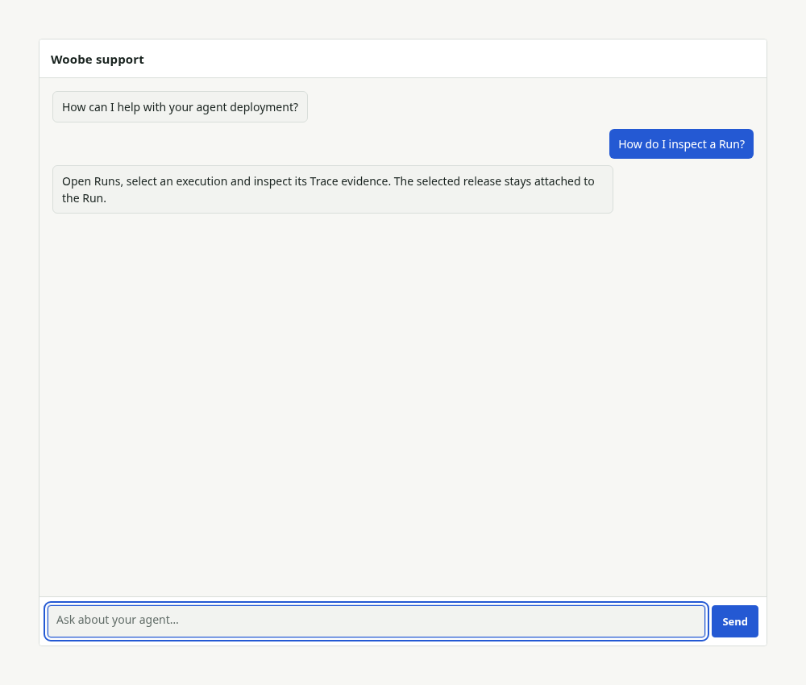

# Woobe browser interface

These are Chromium captures of the implemented Woobe interface. They use deterministic, synthetic API fixtures from `tests/e2e/fixtures`, not production accounts or measured platform performance. No model provider is contacted. The fixture's reference time is June 20, 2026; it is not the capture date.

The screenshots cover the Control Plane in `woobe-frontend`, shared presentation from `woobe-ui`, and the independently built `woobe-embed` ChatSurface. Automated accessibility checks cover the Overview, ten resource families and ChatSurface. Browser tests also check navigation, Project scope, environment selection, release context, form errors, mobile navigation, keyboard submission and accessible presentation. They do not certify a deployed backend or a real provider integration.

## Project operations


The Overview retains the selected period and environment. Unknown configuration, missing pricing and execution failures remain explicit; the design does not manufacture healthy status.

| Surface | Capture |
| --- | --- |
| Agent inventory | [Agents](agents.png) |
| Agent creation | [Creation workspace](create-agent.png) |
| Multiple Networks in one Project | [Networks](networks.png) |
| Agent release context and settings | [Agent playground](agent-playground.png) |
| Network entry-point setup | [Network workspace](network-workspace.png) |
| Run ledger | [Runs](traces.png) |
| Empty usage scope | [Usage](usage.png) |

## Configuration and resources

| Surface | Capture |
| --- | --- |
| Knowledge | [Collections and ingestion](knowledge.png) |
| Tools | [HTTP and MCP tools](tools.png) |
| Skills | [Skill inventory](skills.png) |
| Models | [Generation and embedding models](models.png) |
| Credentials | [Provider credentials](credentials.png) |
| Runtime Keys | [API Keys](api-keys.png) |
| Environment configuration | [Environments](environments.png) |
| Published conversational surfaces | [ChatSurfaces](chat-surfaces.png) |

Empty inventories are intentional fixture states, not evidence that a backend has no resources. Secret material is never included in these captures.

## Access and conversation



[Mobile console at 360px](mobile-console.png) exercises the navigation Drawer and its Escape/focus-return behavior. The same browser suite covers 768, 1024, 1440 and 1920px viewports.



ChatSurface keeps its own appearance configuration. The console's light canvas and dark rail do not override the customer's configured embed colors or sizing.

## Reproduce

Install the locked frontend and embed dependencies, then the browser test dependencies:

```bash
npm --prefix packages/woobe-frontend ci
npm --prefix packages/woobe-embed ci
npm --prefix tests/e2e ci
cd tests/e2e
npx playwright install --with-deps chromium
WOOBE_CAPTURE_DOCS=1 npx playwright test
```

Playwright builds and serves both browser artifacts, runs the assertions and writes the captures to `docs/screenshots` only when `WOOBE_CAPTURE_DOCS=1`. Ordinary test runs write only their usual test artifacts. Review image changes before committing them.

For a managed cloud machine with an existing Chromium, set `PLAYWRIGHT_CHROMIUM_EXECUTABLE=/usr/bin/chromium`. If using a custom `PLAYWRIGHT_BROWSERS_PATH`, install Playwright's ffmpeg there too; video evidence remains enabled for failures. The cloud validation used the system Chromium and system ffmpeg through the local Playwright cache.

When supplying `PLAYWRIGHT_BASE_URL`, start both artifacts yourself and provide `PLAYWRIGHT_EMBED_BASE_URL` if the embed is not served on port 4181. Browser HTTP fixtures are installed by the tests and never enabled in product code.
