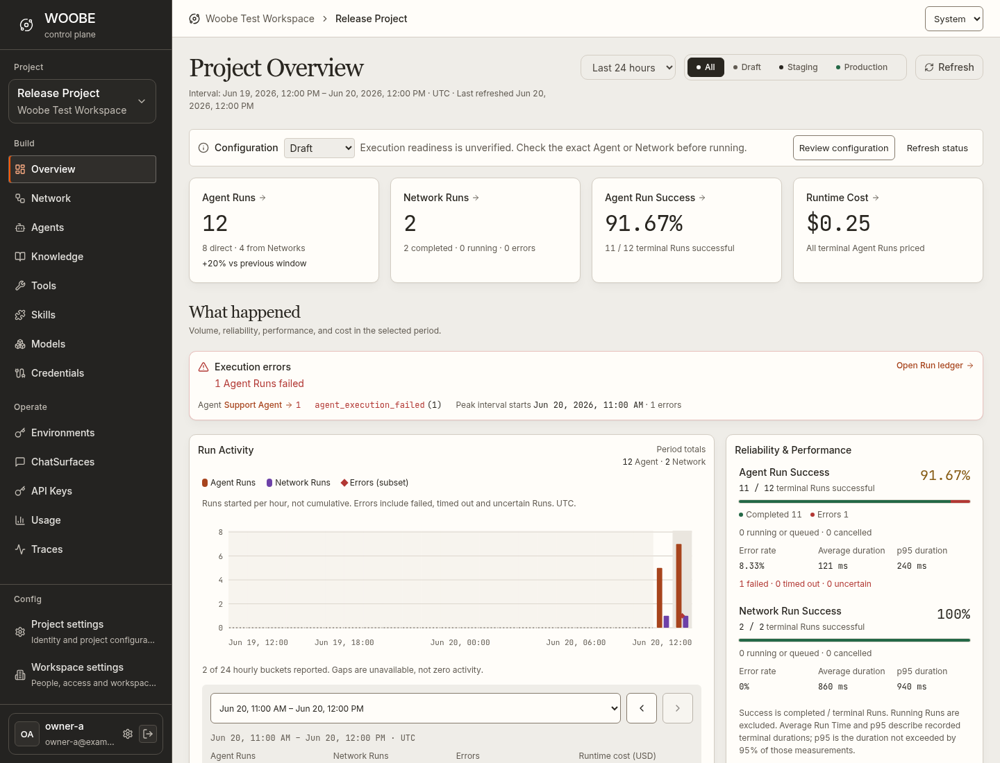

# Woobe main pages

Updated Chromium captures of the production application, using synthetic API fixtures. Main pages are retained, with four comparable light/dark workspace captures requested for the theme refinement. Component and modal screenshots stay outside documentation.



18 main pages × 3 widths + 4 theme comparisons = 58 images. Desktop 1440 × 1100, tablet 768 × 1100, mobile 390 × 1100.

| Page | Desktop | Tablet | Mobile |
| --- | --- | --- | --- |
| Sign in | [View](sign-in.png) | [View](tablet/sign-in.png) | [View](mobile/sign-in.png) |
| Workspaces | [View](workspaces.png) | [View](tablet/workspaces.png) | [View](mobile/workspaces.png) |
| Projects | [View](projects.png) | [View](tablet/projects.png) | [View](mobile/projects.png) |
| Project Overview | [View](project-overview.png) | [View](tablet/project-overview.png) | [View](mobile/project-overview.png) |
| Agents | [View](agents.png) | [View](tablet/agents.png) | [View](mobile/agents.png) |
| Networks | [View](networks.png) | [View](tablet/networks.png) | [View](mobile/networks.png) |
| Agent playground | [View](agent-playground.png) | [View](tablet/agent-playground.png) | [View](mobile/agent-playground.png) |
| Network workspace | [View](network-workspace.png) | [View](tablet/network-workspace.png) | [View](mobile/network-workspace.png) |
| Knowledge | [View](knowledge.png) | [View](tablet/knowledge.png) | [View](mobile/knowledge.png) |
| Tools | [View](tools.png) | [View](tablet/tools.png) | [View](mobile/tools.png) |
| Skills | [View](skills.png) | [View](tablet/skills.png) | [View](mobile/skills.png) |
| Models | [View](models.png) | [View](tablet/models.png) | [View](mobile/models.png) |
| Credentials | [View](credentials.png) | [View](tablet/credentials.png) | [View](mobile/credentials.png) |
| Environments | [View](environments.png) | [View](tablet/environments.png) | [View](mobile/environments.png) |
| API Keys | [View](api-keys.png) | [View](tablet/api-keys.png) | [View](mobile/api-keys.png) |
| ChatSurfaces | [View](chat-surfaces.png) | [View](tablet/chat-surfaces.png) | [View](mobile/chat-surfaces.png) |
| Usage | [View](usage.png) | [View](tablet/usage.png) | [View](mobile/usage.png) |
| Runs | [View](traces.png) | [View](tablet/traces.png) | [View](mobile/traces.png) |

## Workspace theme comparisons

| Workspace | Light | Dark |
| --- | --- | --- |
| Agent Playground, expanded Run and context bars | [View](themes/agent-playground-light.png) | [View](themes/agent-playground-dark.png) |
| Network workspace | [View](themes/network-workspace-light.png) | [View](themes/network-workspace-dark.png) |

## Reproduce

Install the locked dependencies in `packages/woobe-frontend`, `packages/woobe-embed` and `tests/e2e`. Install Playwright Chromium and the local Georgia family as described in [font provenance](../design/FONTS.md). From `tests/e2e`:

```sh
WOOBE_CAPTURE_DOCS=1 WOOBE_REQUIRE_GEORGIA=1 npx playwright test --config playwright.config.ts tests/surface-coverage.spec.ts tests/typography.spec.ts
WOOBE_CAPTURE_REFINEMENT=1 npx playwright test --config playwright.config.ts tests/workspace-refinement.spec.ts
cd ../..
python3 scripts/frontend_visual_inventory.py
```

In this cloud environment, set `PLAYWRIGHT_CHROMIUM_EXECUTABLE=/usr/bin/chromium` and `PLAYWRIGHT_BROWSERS_PATH=/workspace/.playwright`. The suite builds the real frontend and independent embed before capture. Public and product pages use their actual routers. Images show the initial viewport; long operational content remains scrollable in the application.

The [gallery](index.html) provides thumbnails. [Source inventory and image hashes](../design/coverage.json), [rendered font evidence](../design/fonts/) and [review results](../design/REVIEW.md) record separate checks. Fixtures do not prove live backend or provider integration. Georgia is installed locally for these captures; other clients follow the declared serif fallback stack.

Component/overlay browser tests remain enabled. Optional auxiliary captures use `WOOBE_CAPTURE_AUXILIARY=1` and stay in ignored test output, outside this documentation.
